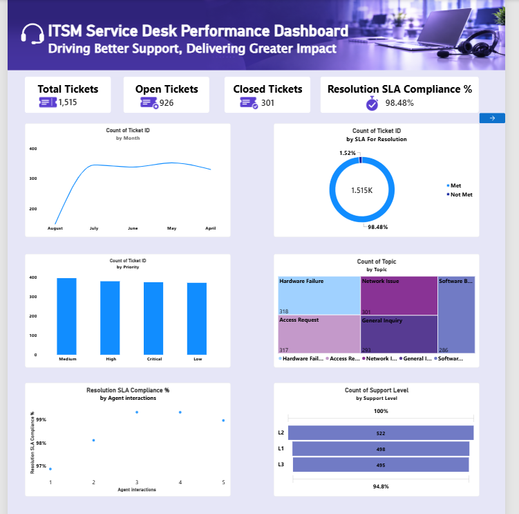

# itsm-service-desk-performance-dashboard
Interactive Power BI dashboard analyzing IT service desk performance, ticket trends, and SLA compliance.
# ITSM Service Desk Performance Dashboard | Power BI

## Project Overview

Developed an interactive Power BI dashboard to monitor IT service desk operations, analyze ticket distribution, evaluate resolution SLA compliance, and identify factors influencing service desk performance.

## Objectives

- Monitor service desk ticket volume and distribution.
- Analyze ticket resolution performance and SLA compliance.
- Identify trends across ticket categories, priorities, and statuses.
- Explore factors influencing service desk performance.
- Support operational monitoring and data-driven decision-making.

## Tools and Technologies

- **Microsoft Power BI** – Dashboard development and reporting
- **Power Query** – Data cleaning and transformation
- **DAX** – KPI and measure calculations
- **Key Influencers** – Exploring factors associated with outcomes
- **Decomposition Tree** – Interactive drill-down analysis

## Key Contributions

- Cleaned, transformed, and prepared service desk data using Power Query.
- Created DAX measures and KPIs to monitor ticket distribution, resolution performance, and SLA compliance.
- Analyzed ticket patterns across categories, priorities, statuses, and other relevant dimensions.
- Developed interactive visualizations, KPI cards, slicers, Key Influencers, and Decomposition Tree visuals.
- Designed a multi-page dashboard to explore operational trends and support service quality improvement.

## Dashboard Preview

## Skills Demonstrated

Power BI, Power Query, DAX, Data Cleaning, Data Transformation, KPI Analysis, SLA Analysis, Data Visualization, Dashboard Development, and Business Insights.

